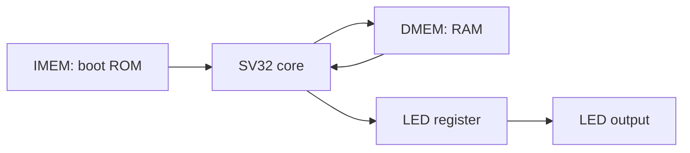

# SV32 blinky SoC and DE25-NANO

The SoC combines the generated `sv32_core`, a boot ROM, a byte-write RAM,
and a memory-mapped LED. The only required generic inputs are `clk` and
active-low `rst_n`. Outputs are `led`, `halted`, and optional `debug_pc`.



## Memories and address map

| Interface | Byte addresses | Default size | Behavior |
| --- | --- | --- | --- |
| Instruction fetch | `0x00000000`–`0x000003ff` | 256 × 32-bit words | ROM loaded from `blinky.hex` |
| Data RAM | `0x00001000`–`0x000013ff` | 256 × 32-bit words | Asynchronous read, rising-edge byte writes |
| LED MMIO | `0x10000000`–`0x10000003` | One bit | Lane 0 writes bit 0; reads return 0 or 1 |
| Unmapped data | All other addresses | — | Reads return zero; writes are ignored |

`src/sv32_soc/sv32_imem.v` and `sv32_dmem.v` are synthesizable memory
modules with `WORDS` and optional `INIT_FILE` parameters. They check the full
address before indexing, so out-of-range accesses do not wrap into valid RAM.
ROM holes and out-of-range instruction fetches return zero, an unsupported
instruction that halts the core.

RAM contents are preserved during reset, and reset suppresses RAM writes.
RAM has no power-up initialization unless `DMEM_INIT_FILE` is supplied; the
blinky firmware explicitly initializes its counter before reading it.

The single-cycle core requires asynchronous reads. On the DE25-NANO these
memories synthesize into ROM logic and RAM registers/multiplexers rather than
synchronous block RAM. This matches the supported
[Yosys asynchronous-memory patterns](https://yosyshq.readthedocs.io/projects/yosys/en/latest/using_yosys/synthesis/memory.html).

## Blinky firmware

`programs/blinky.py` emits 13 RV32I instructions without a cross compiler.
The program initializes a counter in RAM, then repeatedly loads it, increments
and stores it, and writes its lowest bit to the LED register. A decrement/BNE
delay loop separates LED writes; a JAL returns to the counter loop.

Each toggle interval is exactly `2 * delay_iterations + 8` CPU cycles. The
default delay is 24,999,996, giving a 0.5-second toggle interval and a one-second
complete blink at 100 MHz. The first LED-on write occurs eight CPU cycles after
reset release.

Generate the core and hardware ROM image:

```bash
python3 scripts/build-soc.py
```

Outputs are in `build/sv32_soc/`: `sv32_core.v`, `blinky.hex`, the readable
`blinky.lst`, `files.f`, and `soc-config.json`. Instantiate `sv32_soc` and
compile the generated core plus the three files under `src/sv32_soc/`.
For a custom build directory, pass its ROM path as `IMEM_INIT_FILE`.

## Simulation and synthesis checks

```bash
python3 scripts/test-soc.py --synthesize
```

This uses a shortened delay of eight iterations while keeping the same
instructions as the hardware program. It checks:

- ROM initialization and bounds; every RAM byte lane, neighboring-byte
  preservation, out-of-range writes, and reset write suppression.
- Six LED transitions at exact cycle counts, repeated after reset with RAM
  already used.
- RAM halfword stores, LED readback and byte enables, and unmapped data
  accesses, using a self-checking CPU program.
- The DE25-NANO wrapper's synchronized reset and active-low LED wiring,
  using a behavioral clocking model; the real clock/reset IP is checked by
  Quartus.
- Yosys synthesis and `check -assert`, followed by the same blinky test on
  the synthesized gate netlist.

Logs and waveforms are under `build/sv32_soc_test/`. Open
`rtl/blinky.vcd` or `gate/blinky.vcd` in a waveform viewer. To exercise the
constant-loading sequence across a signed-immediate boundary:

```bash
python3 scripts/test-soc.py --delay-iterations 2048 \
  --output-dir build/sv32_soc_carry_test
```

## DE25-NANO at 100 MHz

The board wrapper is `boards/de25_nano/sv32_de25_nano.v`. Terasic's
[DE25-NANO manual](https://mm.digikey.com/Volume0/opasdata/d220001/medias/docus/7704/P0804.pdf)
identifies the device as `A5EB013BB23BE4SR1` and specifies these connections:

| Project port | FPGA pin | I/O standard | Function |
| --- | --- | --- | --- |
| `CLOCK1_50` | `V16` | 3.3-V LVCMOS | 50 MHz reference clock |
| `KEY0_N` | `C8` | 3.3-V LVCMOS | Active-low push-button reset |
| `LED0_N` | `DF35` | 1.1 V | Active-low user LED 0 |

The generated Altera IOPLL produces a 100 MHz CPU clock from the 50 MHz
reference. The Agilex 5 Reset Release IP holds the design in reset during
configuration. Reset remains asserted until the PLL locks; release is
synchronized with two flip-flops. The board wrapper handles LED polarity.
The hard processor system and external SDRAM/LPDDR4 are not used.

With Quartus Prime Pro and Agilex 5 device support on `PATH`, generate the
project and vendor clock/reset IP:

```bash
python3 scripts/build-de25.py
```

Run the full synthesis, fitter, timing, and assembler flow:

```bash
python3 scripts/build-de25.py --compile
```

The project is `build/de25_nano/sv32_de25_nano.qpf`. Build output and timing
reports are in `output_files/`, with the complete log in `quartus-build.log`.
The script verifies the 10 ns CPU clock, requires setup and hold reports,
and rejects negative timing slack. Its results are saved in
`timing-verification.json`.
The programming image is `output_files/sv32_de25_nano.sof`. Load that file
through Quartus Programmer using the onboard USB-Blaster III. LED 0 blinks
once per second; pressing KEY0 restarts the program.

The scripts generate files and build the image; they do not program the board.

## Verified build

On 2026-10-12, Quartus Prime Pro 26.1.1 completed synthesis, fitting,
timing analysis, and assembly for `A5EB013BB23BE4SR1`. The 100 MHz CPU clock
met timing with setup slack **+0.553 ns** and hold slack **+0.111 ns**;
recovery, removal, and pulse-width checks also passed. The generated `.sof`
is approximately 986 KiB. Post-fit design closure passes, with no high- or
medium-severity signoff violations; the final timing recheck is recorded in
`build/de25_nano/timing-recheck.log`.

Memory, MMIO, board-wrapper, RTL blinky, and synthesized-netlist blinky tests
all passed, including reset/restart and the delay constant's signed-immediate
boundary. The existing 23 DSLX tests, 35 core RTL programs, default/custom
module tests, and 14 tooling tests also passed. Physical board programming
and observation have not been performed.
