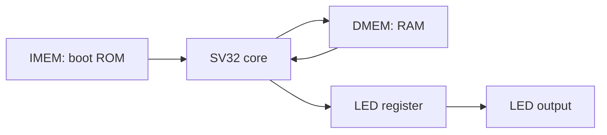

# SV32 blinky SoC and DE25-NANO

The SoC combines the generated `sv32_core`, a boot ROM, a byte-write RAM,
and a memory-mapped LED. The only required generic inputs are `clk` and
active-low `rst_n`. Outputs are `led`, `halted`, and optional `debug_pc`.

The core is entirely generated by XLS from `src/sv32/sv32_core.x`; the SoC,
memories, and board wrapper remain Verilog. `sv32_soc` connects its reset to both
core reset inputs (`rst_n` for generated state storage and `reset_n` for DSLX
store suppression). The external SoC interface is unchanged.



## Memories and address map

| Interface | Byte addresses | Default size | Behavior |
| --- | --- | --- | --- |
| Instruction fetch | `0x00000000`–`0x000003ff` | 256 × 32-bit words | ROM loaded from `blinky.hex` |
| Data RAM | `0x00001000`–`0x000013ff` | 256 × 32-bit words | Asynchronous read, rising-edge byte writes |
| LED MMIO | `0x10000000`–`0x10000003` | One bit | Lane 0 writes bit 0; reads return 0 or 1 |
| Unmapped data | All other addresses | — | Reads return zero; writes are ignored |

`src/sv32_soc/sv32_imem.v` and `sv32_dmem.v` are synthesizable memory
modules with `WORDS` and optional `INIT_FILE` parameters. They check the full
address before indexing, so out-of-range accesses do not wrap into valid RAM.
ROM holes and out-of-range instruction fetches return zero, an unsupported
instruction that halts the core.

RAM contents are preserved during reset, and reset suppresses RAM writes.
RAM has no power-up initialization unless `DMEM_INIT_FILE` is supplied; the
blinky firmware explicitly initializes its counter before reading it.

The single-cycle core requires asynchronous reads. On the DE25-NANO,
Quartus implements these memories as ROM logic and RAM registers/multiplexers
rather than synchronous block RAM.

## Blinky firmware

`programs/blinky.py` emits 13 RV32I instructions without a cross compiler.
The program initializes a counter in RAM, then repeatedly loads it, increments
and stores it, and writes its lowest bit to the LED register. A decrement/BNE
delay loop separates LED writes; a JAL returns to the counter loop.

Each toggle interval is exactly `2 * delay_iterations + 8` CPU cycles. The
default delay is 24,999,996, giving a 0.5-second toggle interval and a one-second
complete blink at 100 MHz. The first LED-on write occurs eight CPU cycles after
reset release.

Generate the core and hardware ROM image:

```bash
python3 scripts/build-soc.py
```

Outputs are in `build/sv32_soc/`: `sv32_core.v`, `blinky.hex`, the readable
`blinky.lst`, `files.f`, and `soc-config.json`. Instantiate `sv32_soc` and
compile the generated core plus the three files under `src/sv32_soc/`.
For a custom build directory, pass its ROM path as `IMEM_INIT_FILE`.

## Compiled C ROM firmware

`programs/blinky.c` builds with the bare-metal RISC-V GCC toolchain installed
under `/opt/riscv/bin`. Use `riscv32-unknown-elf-gcc` from `PATH`; the build
explicitly selects `rv32i` and `ilp32`, with no compressed, multiply/divide,
floating-point, or atomic instructions. It links without libc or an OS.

`programs/crt0.S` starts at address zero, sets a 16-byte-aligned stack at
`0x1400`, clears `.bss`, and calls `main`. If `main` returns, `EBREAK` halts
the core. `programs/sv32.ld` places instructions in the 1 KiB ROM and BSS
in RAM at `0x1000`; it reserves the upper 256 RAM bytes for the stack.
Small-data addressing and linker relaxation are disabled, so startup does
not need a global pointer.

Build firmware alone, or integrate it with the SoC and Quartus board project:

```bash
python3 scripts/build-firmware.py
python3 scripts/build-soc.py --firmware c --output-dir build/sv32_soc_c
python3 scripts/test-soc.py --firmware c --output-dir build/sv32_soc_c_test
python3 scripts/build-de25.py --firmware c --seed 2 --output-dir build/de25_nano_c --compile
```

The standalone output directory is `build/firmware/blinky/`; integrated builds
put the same files in their selected output directory. Outputs include
`blinky.elf`, `blinky.bin`, `blinky.hex`, `blinky.lst`, `blinky.map`,
`blinky.size`, and `firmware-config.json` with compiler/flags and memory symbols.
The `.hex` contains 256 little-endian instruction words for `$readmemh`.
The default C program toggles the LED approximately every 0.5 seconds at
100 MHz; compiler-generated call/loop overhead is included in that interval.

The C simulation uses a short delay and starts RAM with nonzero data. It
checks BSS initialization, counter increments, aligned stack use, regular
LED transitions, and restart after warm reset. It also checks the board's
reset and LED polarity. To exercise a larger delay constant:

```bash
python3 scripts/test-soc.py --firmware c --delay-iterations 2048 \
  --output-dir build/sv32_soc_c_carry_test
```

The current Harvard instruction ROM is not readable through data loads.
The linker rejects initialized `.data` and `.rodata` (including string
constants and lookup tables) until a RAM initialization or shared-memory
scheme is added. It also rejects ROM overflow and BSS/stack overlap. The
current startup supports zero-initialized globals and stack-based C code.

This is firmware embedded in the FPGA ROM. A bootloader that receives and
launches another program needs a transport such as UART or flash and
writable instruction storage; these are future SoC additions.

Changing the firmware also changes the combinational ROM logic synthesized
by Quartus. The CPU RTL is identical between the Python and C builds, but
the complete netlist and placement/routing differ. The load critical path
passes through instruction ROM, address/register logic, asynchronous data
RAM, and load formatting before register writeback, all in one clock cycle.
Every firmware image therefore needs a fresh FPGA timing check.
`build-de25.py --seed N` selects a fitter placement seed (default 1).

The 2026-10-14 Quartus Prime Pro 26.1.1 builds report these 100 MHz results:

| Firmware | Fitter seed | Setup slack | Hold slack |
| --- | --- | --- | --- |
| Python blinky | 1 | +0.353 ns | +0.102 ns |
| C blinky | 1 | -0.078 ns | +0.061 ns |
| C blinky | 2 | +0.001 ns | +0.061 ns |
| C blinky | 3 | -0.005 ns | +0.061 ns |

The seed-2 programming image and passing timing report are under
`build/de25_nano_c/`. Setup margin is only 0.001 ns; the device timing models
are preliminary and physical board testing remains pending. The seed-3
experiment under `build/de25_nano_c_seed3/` does not meet the timing target.
For the passing C image, the design uses 6,674 ALMs and 14,417 registers.

## Simulation checks

```bash
python3 scripts/test-soc.py
```

This uses a shortened delay of eight iterations while keeping the same
instructions as the hardware program. It checks:

- ROM initialization and bounds; every RAM byte lane, neighboring-byte
  preservation, out-of-range writes, and reset write suppression.
- Six LED transitions at exact cycle counts, repeated after reset with RAM
  already used.
- RAM halfword stores, LED readback and byte enables, and unmapped data
  accesses, using a self-checking CPU program.
- The DE25-NANO wrapper's synchronized reset and active-low LED wiring,
  using a behavioral clocking model; the real clock/reset IP is checked by
  Quartus.

Logs and waveforms are under `build/sv32_soc_test/`. Open
`rtl/blinky.vcd` in a waveform viewer. To exercise the
constant-loading sequence across a signed-immediate boundary:

```bash
python3 scripts/test-soc.py --delay-iterations 2048 \
  --output-dir build/sv32_soc_carry_test
```

## DE25-NANO at 100 MHz

The board wrapper is `boards/de25_nano/sv32_de25_nano.v`. Terasic's
[DE25-NANO manual](https://mm.digikey.com/Volume0/opasdata/d220001/medias/docus/7704/P0804.pdf)
identifies the device as `A5EB013BB23BE4SR1` and specifies these connections:

| Project port | FPGA pin | I/O standard | Function |
| --- | --- | --- | --- |
| `CLOCK1_50` | `V16` | 3.3-V LVCMOS | 50 MHz reference clock |
| `KEY0_N` | `C8` | 3.3-V LVCMOS | Active-low push-button reset |
| `LED0_N` | `DF35` | 1.1 V | Active-low user LED 0 |

The generated Altera IOPLL produces a 100 MHz CPU clock from the 50 MHz
reference. The Agilex 5 Reset Release IP holds the design in reset during
configuration. Reset remains asserted until the PLL locks; release is
synchronized with two flip-flops. The board wrapper handles LED polarity.
The hard processor system and external SDRAM/LPDDR4 are not used.

With Quartus Prime Pro and Agilex 5 device support on `PATH`, generate the
project and vendor clock/reset IP. The fitter also requires an Agilex 5
license; allow access to the licensing service when using online licensing.

```bash
python3 scripts/build-de25.py
```

Run the full synthesis, fitter, timing, and assembler flow:

```bash
python3 scripts/build-de25.py --compile
```

The project is `build/de25_nano/sv32_de25_nano.qpf`. Build output and timing
reports are in `output_files/`, with the complete log in `quartus-build.log`.
The script verifies the 10 ns CPU clock, requires setup and hold reports,
and rejects negative timing slack. Its results are saved in
`timing-verification.json`.
The programming image is `output_files/sv32_de25_nano.sof`. Load that file
through Quartus Programmer using the onboard USB-Blaster III. LED 0 blinks
once per second; pressing KEY0 restarts the program.

The scripts generate files and build the image; they do not program the board.

## Current Quartus build (2026-10-14)

Quartus Prime Pro 26.1.1 completed synthesis, fitting, timing analysis, and
assembly for the XLS proc core and `A5EB013BB23BE4SR1` in `build/de25_nano/`.
The 100 MHz CPU clock meets timing with **+0.353 ns setup** and
**+0.102 ns hold** slack. Recovery, removal, and pulse-width checks also pass;
the results are saved in `build/de25_nano/timing-verification.json`.
The design uses 7,259 ALMs and 8,753 dedicated registers.

The current programming image is
`build/de25_nano/output_files/sv32_de25_nano.sof` (1,012,470 bytes).
Compilation completed with zero errors and four warnings about preliminary
device timing models and default I/O electrical settings. The signoff report
contains no high- or medium-severity violations.

Memory, MMIO, RTL blinky, board-wrapper simulations, and all 10 XLS installer
tests pass. Physical board programming and observation remain pending.

## Verified build before the XLS proc migration

The following timing results describe the earlier Verilog-shell core, not the
migrated proc core. On 2026-10-12, Quartus Prime Pro 26.1.1 completed synthesis,
fitting, timing analysis, and assembly for `A5EB013BB23BE4SR1`. The 100 MHz CPU clock
met timing with setup slack **+0.553 ns** and hold slack **+0.111 ns**;
recovery, removal, and pulse-width checks also passed. The generated `.sof`
is approximately 986 KiB. Post-fit design closure passes, with no high- or
medium-severity signoff violations; the final timing recheck is recorded in
`build/de25_nano/timing-recheck.log`.

Memory, MMIO, board-wrapper, RTL blinky, and synthesized-netlist blinky tests
all passed, including reset/restart and the delay constant's signed-immediate
boundary. The existing 23 DSLX tests, 35 core RTL programs, default/custom
module tests, and 14 tooling tests also passed. Physical board programming
and observation have not been performed.

## XLS proc core validation (2026-10-13)

The migrated core passes all 23 DSLX/JIT tests and 35 RTL/reference programs,
including exact cycle counts. Default and custom module builds pass those programs
through both the direct core and `sv32_top`. The additional sequential test checks
asynchronous reset without a clock edge, reset-time store suppression, dependent
instructions on consecutive cycles, state preservation on halt, and restart.

The unchanged Verilog memories, MMIO, and board behavior pass their simulations.
RTL blinky passes with exact LED toggle timing and reset/restart.

A separate Quartus build of the proc core is under `build/de25_nano_xls/`:

```bash
python3 scripts/build-de25.py --output-dir build/de25_nano_xls --compile
```

Quartus Prime Pro 26.1.1 reports **+0.353 ns setup** and **+0.102 ns hold** slack
at 100 MHz for `A5EB013BB23BE4SR1`; recovery, removal, and pulse-width checks also
pass. Synthesis, fitting, timing analysis, and assembly completed, producing
`build/de25_nano_xls/output_files/sv32_de25_nano.sof`. Fitted utilization is
7,259 ALMs and 8,753 dedicated registers for the whole
SoC (including the asynchronous-read data RAM). These results supersede the older
core's timing figures above. Physical board programming and observation remain
pending.
